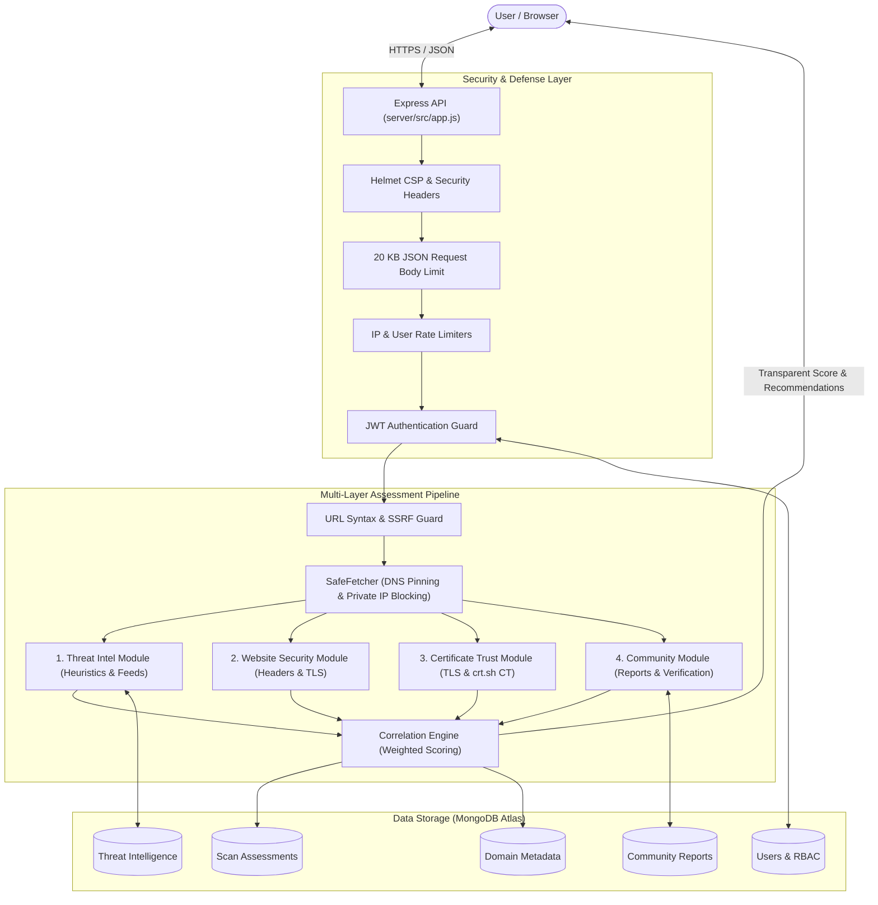

# 🔍 TRUSTLENS — Website Trust Intelligence Platform

[](https://github.com/Pradipta-Programmer/TrustLens)
[](https://nodejs.org/)
[](https://www.mongodb.com/atlas)
[-success.svg)](#10-testing-suite)
[](https://github.com/Pradipta-Programmer/TrustLens/blob/main/LICENSE)

> **Don't just detect threats. Understand website trust.**
> TRUSTLENS is a multi-layered website trust intelligence platform that evaluates target URLs across threat feeds, transport security headers, Certificate Transparency logs, and crowdsourced community reputation — delivering transparent, explainable assessments rather than opaque black-box verdicts.

---

## Table of Contents

1. [Project Overview & Purpose](#1-project-overview--purpose)
2. [Key Features](#2-key-features)
   - [Implemented Features (v1.0.0)](#implemented-features-v100)
   - [Planned Features (v2.0.0 Roadmap)](#planned-features-v200-roadmap)
3. [Technology Stack & Dependency Versions](#3-technology-stack--dependency-versions)
4. [System Architecture & Assessment Pipeline](#4-system-architecture--assessment-pipeline)
5. [SafeFetcher & SSRF Defense Architecture](#5-safefetcher--ssrf-defense-architecture)
6. [Risk Scoring, Confidence & Coverage](#6-risk-scoring-confidence--coverage)
7. [Installation & Setup Instructions (Windows)](#7-installation--setup-instructions-windows)
8. [Environment Variable Configuration (`.env.example`)](#8-environment-variable-configuration-envexample)
9. [Database Setup & Test Isolation](#9-database-setup--test-isolation)
10. [Testing Suite](#10-testing-suite)
11. [REST API Reference](#11-rest-api-reference)
12. [Security Architecture & Defensive Measures](#12-security-architecture--defensive-measures)
13. [Security Disclosures & Limitations](#13-security-disclosures--limitations)
14. [Visual Walkthrough & Screenshots](#14-visual-walkthrough--screenshots)
15. [Future Roadmap](#15-future-roadmap)
16. [License](#16-license)

---

## 1. Project Overview & Purpose

Modern web threats frequently evade traditional perimeter security by acquiring valid, free TLS certificates and cloning brand visual designs. Traditional security tools often present binary "safe" vs. "malicious" badges without explanation, leaving users and developers confused by false positives, unverified warnings, and emerging zero-day threats.

**TRUSTLENS** was engineered to eliminate opaque verdicts by providing an explainable, multi-dimensional **Risk Score (0–100)**:
- **Heuristic Transparency:** Every score penalty and positive finding is enumerated with plain-language explanations.
- **Multi-Vector Assessment:** Evaluates transport security, certificate provenance, known malicious threat feeds, and crowdsourced community reports.
- **Defensive Engineering:** Protects the scanning infrastructure using socket-level IP pinning, streaming response bounds, pre-connection DNS validation, and fail-closed database isolation.

---

## 2. Key Features

### Implemented Features (v1.0.0)

#### 🌐 Web Interface (`frontend/index.html`)
- **Framework-Free SPA Architecture:** Ultra-responsive single-page application built with modern vanilla JavaScript (ES2022), semantic HTML5, and CSS custom properties.
- **Adaptive Dark & Light Theme:** Automatic synchronization with operating system preferences (`prefers-color-scheme`) combined with a persistent manual toggle stored in `localStorage['trustlens_theme']`.
- **Responsive Touch Standards:** Full compatibility with mobile (375px), tablet (768px), and desktop viewports with WCAG &ge;44px touch targets and zero horizontal scroll overflow.
- **Interactive Live Scanner (`#scan`):**
  - Instant URL analysis with animated progress steps and accessible ARIA live regions.
  - Transparent score breakdown with proportional visual weight bars.
  - Positive findings, negative findings, security recommendations, and brand impersonation warnings.
  - Interactive SVG historical trust score timeline with historical point inspection.
  - One-click report summary clipboard export.
  - Integrated offline demo fixtures for evaluation without network dependencies.
- **Live Security Dashboard (`#dashboard`):**
  - Real-time aggregate platform metrics queried live from MongoDB: total scans, high-risk scans, critical scans, and community reports.
  - Visual risk distribution bars and community report category breakdowns.
  - Clickable recent scans that open historical saved assessments (`#scan-${id}`) directly via `GET /api/scans/:id` without re-triggering new scans.
- **Threat Intelligence Explorer (`#explorer`):**
  - Searchable, filterable community threat report registry with debounced text search.
  - Filtering by category (Phishing, Malware, Scams, Brand Impersonation) and status (Verified Malicious, Under Verification, Pending Review, Rejected).
  - One-click "Scan &rarr;" shortcuts pre-populating target domains into the scanner.
- **Community Report Submission (`#report`):**
  - Anonymous guest reporting powered by background JWT token bootstrapping (`POST /api/auth/guest`).
  - Automatic URL trimming on blur and paste to eliminate whitespace validation failures.
  - In-flight double-submit protection disabling buttons during transit.
  - Unique tracking ID generation (`TL-<id>`) and duplicate report conflict handling (`409 DUPLICATE_REPORT`).
- **Certificate Intelligence (`#cert`):**
  - Standalone domain TLS certificate inspector.
  - Live peer certificate validity checks, days remaining countdown, and Certificate Transparency (CT) observation history.
- **Administrator Console (`#admin`):**
  - Secure credential-based administrator login (`POST /api/auth/login`).
  - Three administrative tabs:
    1. **Community Reports Moderation Queue:** Status updates (Verified, Under Verification, Rejected), moderator notes, and automatic domain score recalculation.
    2. **Audit Trail:** Comprehensive audit log view with actor, action, target entity, and structured change diffs.
    3. **External Threat Feeds:** Real-time indicator counts and manual on-demand feed synchronization.

#### ⚙️ Backend Services (`server/src/`)
- **Multi-Layer Assessment Pipeline (`modules/`):**
  - Threat heuristics (IP hostnames, URL length, excessive subdomains, punycode, typosquatting brand Levenshtein distance).
  - Public transport security inspections (HTTPS, HSTS, CSP, X-Frame-Options, X-Content-Type-Options, Referrer-Policy, Permissions-Policy).
  - TLS peer certificate extraction and Certificate Transparency log polling via `crtshClient.js`.
  - Community reputation weighting and deduplication.
- **SafeFetcher (`security/safeFetcher.js`):**
  - WHATWG URL syntax validation.
  - Pre-connection DNS resolution with blocking of private, loopback, multicast, and link-local IP addresses.
  - Strict socket-level IP pinning to eliminate DNS rebinding TOCTOU attacks.
  - Safe redirect following with per-hop IP re-validation.
  - Enforced 1 MB streaming response size cap and 8-second request timeout.
- **Fail-Closed Test Database Isolation (`config/db.js`):**
  - Automatic detection of test environments (`NODE_ENV=test`, `USE_TEST_DB=true`).
  - Dynamic rewriting of connection strings to target strictly `trustlens_test`.
  - Hard assertion guard `assertTestDatabase()` aborting operations if connected to anything other than `trustlens_test`.
- **Background Threat Intelligence Scheduler (`services/feedScheduler.js`):**
  - Recurring scheduled ingestion of OpenPhish and URLhaus feeds into `ThreatIntel` collections.
  - Configurable synchronization interval via environment variables.

---

### Planned Features (v2.0.0 Roadmap)

The following capabilities are planned for upcoming major releases and are not present in v1.0.0:
- [ ] **Zod v4 Architecture Migration:** Upgrade schema engine to Zod 4 to fully resolve upstream advisory GHSA-mrhx-c7xc-m3w5.
- [ ] **Machine Learning Classifier:** On-device or hosted model scoring for lexical domain analysis and semantic content evaluation.
- [ ] **Automated WHOIS & RDAP Domain Age Lookup:** Integration with RDAP services to assess domain registration age and registrar reputation.
- [ ] **Multi-Factor Authentication (MFA):** TOTP-based two-factor authentication for administrative accounts.
- [ ] **Webhook & Alert Notifications:** Real-time webhooks when new verified malicious domains are confirmed by moderators.

---

## 3. Technology Stack & Dependency Versions

TrustLens relies on a minimal, carefully audited dependency tree:

| Component | Technology | Version | Purpose |
|---|---|:---:|---|
| **Runtime** | Node.js | `>= 18.0.0` | Server runtime engine (supports CommonJS & native test runner) |
| **Web Framework** | Express | `4.19.2` | REST API routing and static frontend serving |
| **Database ODM** | Mongoose | `8.5.0` | MongoDB object modeling, schema validation, and connection management |
| **Security Headers** | Helmet | `7.1.0` | Content Security Policy, XSS protection, and frameguard headers |
| **CORS Policy** | cors | `2.8.5` | Origin evaluation and cross-origin access control |
| **Rate Limiting** | express-rate-limit | `7.4.0` | IP and user rate limiting on sensitive and public routes |
| **Authentication** | jsonwebtoken | `9.0.2` | Cryptographic JWT signing and verification |
| **Password Hashing** | bcryptjs | `2.4.3` | Cost-factor 12 salt hashing for administrator and user credentials |
| **Schema Validation** | zod | `3.25.76` | Request payload schema validation (resolves `^3.23.8`) |
| **Configuration** | dotenv | `16.4.5` | Environment variable loader from `server/.env` |
| **Testing Harness** | Node.js Native Runner | Built-in | `node:test` and `node:assert/strict` integration test suites |

---

## 4. System Architecture & Assessment Pipeline



---

## 5. SafeFetcher & SSRF Defense Architecture

All external HTTP/S network operations executed by TrustLens pass through `server/src/security/safeFetcher.js` and `server/src/security/urlGuard.js`.

### Defensive Controls:
1. **Response Size Ceiling:** Streaming response bodies are capped at **1 MB (1,000,000 bytes)** (`LIMITS.maxBodyBytes`). If a remote endpoint exceeds this threshold, the connection stream is immediately destroyed to prevent memory exhaustion.
2. **Total Request Timeout:** A hard **8-second total timeout** (`LIMITS.timeoutMs = 8000`) is enforced across all network socket operations, including DNS resolution, TLS handshake, and body streaming.
3. **Bounded Redirects:** SafeFetcher follows a **maximum of 3 redirects** (`LIMITS.maxRedirects = 3`). Every redirect hop is independently re-validated against SSRF filters before establishing a new socket.
4. **Pre-Connection DNS Validation:** The destination hostname is resolved to all candidate IP addresses before any socket connection is attempted.
5. **Private & Cloud Metadata IP Blocking:** Candidate addresses are checked against IPv4 and IPv6 private, reserved, loopback, link-local, and multicast ranges:
   - `0.0.0.0/8`, `10.0.0.0/8`, `100.64.0.0/10`, `127.0.0.0/8`, `169.254.0.0/16` (AWS/GCP metadata), `172.16.0.0/12`, `192.0.0.0/24`, `192.168.0.0/16`, `198.18.0.0/15`, `224.0.0.0/4`, `240.0.0.0/4`
   - IPv6 `::`, `::1`, `fc00::/7`, `fe80::/10`, `ff00::/8`, and IPv4-mapped IPv6 equivalents (`::ffff:...`).
   - Hostnames `localhost` and `metadata.google.internal` are explicitly blocked.
6. **Socket-Level IP Pinning:** To eliminate Time-of-Check to Time-of-Use (TOCTOU) DNS rebinding attacks, network sockets are created directly to the validated IP address while preserving the original hostname in HTTP `Host` and TLS Server Name Indication (SNI) headers.

---

## 6. Risk Scoring, Confidence & Coverage

The platform calculates a composite **Risk Score (0–100)**:

$$\text{Risk Score} = 0.40 \times S_{\text{threat}} + 0.15 \times S_{\text{sec}} + 0.20 \times S_{\text{cert}} + 0.25 \times S_{\text{comm}}$$

### Risk Classifications
- **Low Risk (0–24):** No significant threat indicators; modern security headers and valid certificates detected.
- **Moderate Risk (25–49):** Missing transport headers, newly issued certificates, or unverified community reports.
- **High Risk (50–74):** Multiple suspicious heuristics, missing critical security settings, or verified community flags.
- **Critical Risk (75–100):** Matched on active malware/phishing feeds (URLhaus/OpenPhish) or confirmed malicious by platform reviewers.

### Confidence & Coverage Metrics
- **Assessment Coverage:** The percentage of security modules (out of 4) that successfully gathered live data during the scan.
- **Confidence Level (`Low`, `Medium`, `High`):** Evaluated based on live response availability, Certificate Transparency log observation depth, and corroborating community data.

---

## 7. Installation & Setup Instructions (Windows)

### Prerequisites
- **Node.js:** v18.0.0 or higher ([Download Node.js](https://nodejs.org/))
- **Git:** Git for Windows ([Download Git](https://git-scm.com/))
- **MongoDB:** A MongoDB Atlas cluster or local MongoDB instance (v6.0+)

### Step 1: Clone the Repository
Open PowerShell and clone the project:
```powershell
git clone https://github.com/Pradipta-Programmer/TrustLens.git
cd TrustLens
```

### Step 2: Install Server Dependencies
```powershell
cd server
npm install
cd ..
```

---

## 8. Environment Variable Configuration (`.env.example`)

TrustLens reads configuration from `server/.env`. A clean, placeholder template is provided at `server/.env.example`.

### Create your local `.env`:
```powershell
Copy-Item server/.env.example server/.env
```

### Environment Variables Reference

| Variable | Required in Production | Default | Purpose & Constraints |
|---|:---:|:---:|---|
| `PORT` | Yes | `4000` | Port for the Express REST API and frontend server (1–65535) |
| `NODE_ENV` | Yes | `development` | Environment mode (`development`, `production`, or `test`) |
| `MONGODB_URI` | Yes | — | MongoDB connection string (Atlas or local) |
| `MONGODB_TEST_URI` | No | — | Optional test database URI override (defaults to `trustlens_test`) |
| `JWT_SECRET` | Yes | — | Cryptographic secret for signing JWTs (**minimum 32 characters in production**) |
| `JWT_EXPIRES_IN` | No | `2h` | Expiration window for standard user authentication tokens |
| `CORS_ORIGIN` | No | `""` | Comma-separated allowed frontend origins (denies cross-origin if empty) |
| `TRUST_PROXY` | No | `false` | Reverse proxy trust mode (`true`, `false`, `loopback`, or hop number) |
| `ENABLE_BACKGROUND_FEED_SYNC` | No | `false` | Enable automatic background synchronization of threat feeds |
| `FEED_SYNC_INTERVAL_HOURS` | No | `6` | Sync interval in hours for external threat feeds |
| `ADMIN_EMAIL` | No | — | Administrator email for seeding (`npm run seed:admin`) |
| `ADMIN_PASSWORD` | No | — | Administrator password for seeding (**minimum 12 characters**) |

> [!WARNING]
> Never commit `server/.env` to version control. It is explicitly ignored by `.gitignore`.

---

## 9. Database Setup & Test Isolation

### Preparing Indexes
To enforce uniqueness constraints on user accounts and community report deduplication, run:
```powershell
node server/src/scripts/prepareTestIndexes.js
```

### Database Test Isolation Guarantee
TrustLens enforces strict fail-closed database isolation:
- Whenever `NODE_ENV=test` or `USE_TEST_DB=true`, `server/src/config/db.js` automatically routes database connections to **`trustlens_test`**.
- The `assertTestDatabase()` guard aborts execution if any test worker attempts to connect to or mutate production data.

### Seeding an Administrator Account (Optional)
To initialize an administrator account for testing the moderation console:
```powershell
$env:ADMIN_EMAIL="admin@example.com"
$env:ADMIN_PASSWORD="YourSecurePassword123!"
node server/src/scripts/seedAdmin.js
```

---

## 10. Testing Suite

TrustLens includes an automated backend test suite.

### Reproducible Backend Integration Tests (176 / 176 Passing)
Run the complete backend integration suite using Node.js's native test runner against the isolated `trustlens_test` database:
```powershell
cd server
npm test
```

#### Test Coverage Matrix (11 Modules):
1. `authAndIndexes.test.js`: User registration, login, logout, password hashing, and unique index enforcement.
2. `scans.test.js`: Live URL scanning pipeline, HTTP header inspection, heuristic scoring, and scan persistence.
3. `reports.test.js`: Community report submission, auto-trimming, in-flight guards, and duplicate rejection.
4. `certificates.test.js`: Certificate record queries, days remaining calculations, and SAN validation.
5. `dashboard.test.js`: Metric aggregations, live scan risk distribution, and category counts.
6. `admin.test.js`: Administrative authentication, moderation workflows, and audit trail logging.
7. `safeFetcher.test.js`: SSRF blocking, IP pinning, 1 MB streaming limit, and 8-second timeout enforcement.
8. `urlGuard.test.js`: Private/reserved IPv4 & IPv6 CIDR range blocking and WHATWG URL validation.
9. `threatFeed.test.js`: URLhaus and OpenPhish ingestion, hashing, and TTL expiration.
10. `correlation.test.js`: Multi-vector weighted score mathematics, confidence level, and recommendation synthesis.
11. `health.test.js`: Service health, liveness, and readiness probes.

### Historical Browser User Acceptance (12 / 12 Passing)
During Phase 6 release validation, all 12 user journeys were tested in headless Google Chrome via the Chrome DevTools Protocol (CDP) against a live local instance and `trustlens_test`. Full results and visual artifacts are documented in `PRIORITY_6_3_BROWSER_ACCEPTANCE_REPORT.md`.

---

## 11. REST API Reference

All routes are served under `/api` and return standard JSON envelopes (`{ ok: true, data: ... }` or `{ ok: false, error: { code, message } }`).

### Public Endpoints

| Method | Endpoint | Description | Rate Limit |
|---|---|---|---|
| `GET` | `/api/health` | Service and database liveness check | None |
| `GET` | `/api/health/ready` | Orchestrator readiness probe (returns 200 or 503) | None |
| `POST` | `/api/scans` | Submit a website URL for security assessment | 30 req / min |
| `GET` | `/api/scans` | Query paginated historical scan assessments | 60 req / min |
| `GET` | `/api/scans/:id` | Retrieve saved historical scan result by ID | 60 req / min |
| `GET` | `/api/dashboard/stats` | Live aggregate metrics, risk distribution, and recent scans | 60 req / min |
| `GET` | `/api/reports` | Query paginated community reports with search & filters | 60 req / min |
| `POST` | `/api/reports` | Submit a new community suspicious website report | 20 req / hour |
| `GET` | `/api/certificates` | Query paginated cached certificate records | 60 req / min |
| `GET` | `/api/certificates/:domain` | Inspect TLS peer certificate and CT log observations | 60 req / min |
| `POST` | `/api/auth/register` | Register a new user account | 15 req / 15 min |
| `POST` | `/api/auth/login` | Authenticate existing administrator or user | 15 req / 15 min |
| `POST` | `/api/auth/guest` | Issue an anonymous guest JWT for community reporting | 60 req / 15 min |

### Protected Endpoints (Bearer JWT Required)

| Method | Endpoint | Required Role | Description | Rate Limit |
|---|---|:---:|---|---|
| `GET` | `/api/users/me` | User / Admin | Retrieve current authenticated user profile | 60 req / min |
| `GET` | `/api/reports/mine` | User / Guest | Retrieve reports submitted by the current token | 60 req / min |
| `GET` | `/api/admin/reports` | Admin / Reviewer | Moderation queue for community submissions | 60 req / min |
| `PATCH`| `/api/admin/reports/:id`| Admin / Reviewer | Update report status (`verified`, `rejected`, etc.) | 60 req / min |
| `GET` | `/api/admin/audit` | Admin | Query system audit trail logs | 60 req / min |
| `GET` | `/api/admin/stats` | Admin / Reviewer | Administrative moderation statistics | 60 req / min |
| `GET` | `/api/admin/threat-intel/status` | Admin | Threat feed indicator counts and sync health | 60 req / min |
| `POST`| `/api/admin/threat-intel/sync` | Admin | Trigger on-demand sync of URLhaus and OpenPhish | 60 req / min |

---

## 12. Security Architecture & Defensive Measures

1. **Content Security Policy (CSP):** Helmet configures sandboxing (`default-src 'self'`) with restricted styles and fonts.
2. **Transport Request Cap:** `express.json({ limit: '20kb' })` rejects oversized payloads before reaching validation schemas.
3. **Multi-Tier Rate Limiting:** Global `/api` limiter (120 req/min), credential brute-force protection (15 req/15 min), and report submission caps (20 req/hour).
4. **Credential Security:** Passwords hashed with bcrypt cost-factor 12. Authentication secrets enforce 32-character minimums in production.
5. **Correlation ID Tracking:** Every request receives a unique `X-Correlation-ID` header for distributed tracing.

---

## 13. Security Disclosures & Limitations

### ⚠️ Open Dependency Advisory: Zod (GHSA-mrhx-c7xc-m3w5)
- **Vulnerability Summary:** Upstream advisory [GHSA-mrhx-c7xc-m3w5](https://github.com/advisories/GHSA-mrhx-c7xc-m3w5) identifies a Regular Expression Denial of Service (ReDoS) / memory exhaustion in Zod when validating extremely large, specially crafted strings with `.email()` or `.url()` schemas.
- **Installed Version:** `zod@3.25.76` (resolves `^3.23.8`).
- **Remediation Status:**
  - Upstream Zod did not backport fixes to the 3.x branch. Version `3.25.76` is the terminal release of Zod 3.
  - The first patched release is `zod@4.6.6` (SemVer Major), which introduces breaking API changes that require significant schema refactoring.
- **Active Mitigations:**
  - Express rejects payloads exceeding 20 KB (`express.json({ limit: '20kb' })`) before schema parsing.
  - All schema strings enforce explicit boundaries (`max(2048)` for URLs, `max(254)` for emails).
  - *These measures reduce exploitability but do not constitute an upstream patch.*
- **Resolution Plan:** Full migration to Zod v4 is scheduled for TrustLens v2.0.0.

### 🛡️ Operational Security Limitations
- **Valid HTTPS is not proof of safety:** Threat actors frequently obtain valid TLS certificates through automated Certificate Authorities. An "A" certificate rating does not indicate that a website is trustworthy or benign.
- **Certificate age is neutral:** Newly issued certificates occur routinely during normal website deployments. Low certificate age is an indicator for caution, not proof of malicious intent.
- **Community reports are crowdsourced:** Unverified community submissions represent unvetted user reports. Only reports marked `Verified Malicious` have undergone moderator investigation.
- **Explainable heuristics are not a guarantee:** TrustLens calculates risk transparently using measurable indicators. It does not provide an absolute guarantee against sophisticated zero-day threats.

---

## 14. Visual Walkthrough & Screenshots

*Visual previews captured during browser acceptance testing:*

| Interface View | Description | Preview |
|---|---|:---:|
| **Scanner View** | Interactive scanner with live progress indicators and transparent score card. | *(Screenshot placeholder: `docs/screenshots/03_scan_result.png`)* |
| **Security Dashboard** | Aggregate metrics, live scan risk distribution, and recent scans. | *(Screenshot placeholder: `docs/screenshots/04_dashboard.png`)* |
| **Threat Explorer** | Community-submitted threat reports with category and status filters. | *(Screenshot placeholder: `docs/screenshots/07_threat_explorer.png`)* |
| **Certificate Intelligence** | TLS peer certificate validity breakdown and Certificate Transparency timeline. | *(Screenshot placeholder: `docs/screenshots/08_certificate_intel.png`)* |
| **Administrator Console** | Reviewer moderation queue, system audit trail, and threat feed status. | *(Screenshot placeholder: `docs/screenshots/09_admin_console.png`)* |
| **Mobile Responsiveness** | Adaptive layout with WCAG &ge;44px touch targets on mobile viewports. | *(Screenshot placeholder: `docs/screenshots/11_mobile_viewport.png`)* |

---

## 15. Future Roadmap

- **v1.1.0:** WHOIS & RDAP domain registration age lookup.
- **v1.2.0:** Two-Factor Authentication (TOTP) for administrator accounts.
- **v2.0.0:** Complete Zod v4 migration resolving GHSA-mrhx-c7xc-m3w5 and machine learning lexical domain analysis.

---

## 16. License

This project is licensed under the **MIT License** — see the [LICENSE](https://github.com/Pradipta-Programmer/TrustLens/blob/main/LICENSE) file for details.

Copyright (c) 2026 Pradipta Singha
